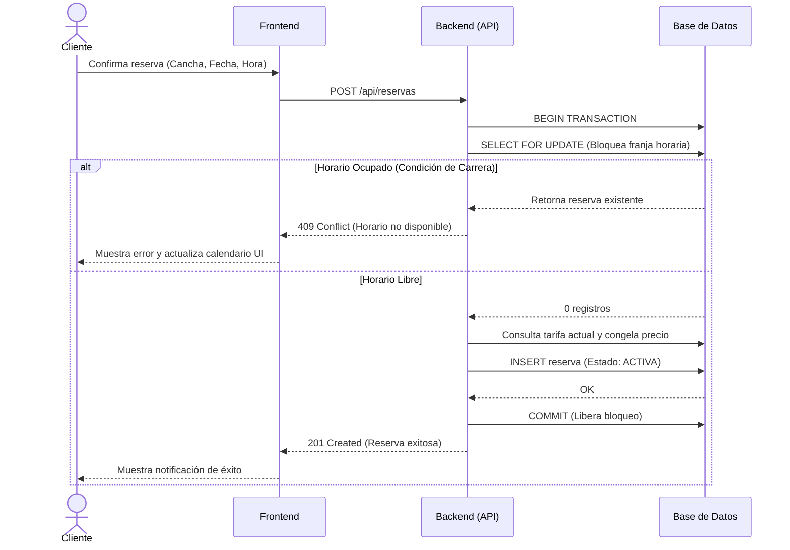

# 📐 Diseño Técnico y Control de Concurrencia — HU06

## 1. Introducción

Para evitar problemas de sobreventa y condiciones de carrera (*race conditions*) cuando dos o más usuarios intentan reservar simultáneamente la misma cancha deportiva en la misma fecha y franja horaria, el sistema **CourtMaster Pro** implementa un modelo de **bloqueo pesimista en base de datos** (`SELECT FOR UPDATE` en PostgreSQL) gestionado bajo un contexto transaccional estricto (`@Transactional`). Al abrir la transacción, el motor adquiere un bloqueo exclusivo sobre la franja horaria consultada, serializando el acceso de solicitudes concurrentes y garantizando la exclusión mutua y la integridad ACID antes de consolidar cualquier reserva.

---

## 2. Diagrama de Secuencia Transaccional

A continuación se detalla la interacción entre el cliente, la interfaz de usuario, el backend y la base de datos PostgreSQL durante el ciclo de confirmación de reserva:

---

## 3. Explicación Detallada de los Flujos de Ejecución

### 🟢 Escenario 1: Horario Libre (`201 Created` — Reserva Exitosa)
* **A nivel de Base de Datos (BD):**
  1. La transacción inicia en PostgreSQL (`BEGIN TRANSACTION`) al recibir la solicitud en el servicio transaccional.
  2. Se ejecuta la consulta pesimista `SELECT ... FOR UPDATE` buscando reservas activas en la cancha, fecha y hora indicadas.
  3. La consulta retorna cero registros coincidentes, confirmando que la franja horaria está disponible.
  4. El backend consulta la `tarifa_base` configurada en la cancha para congelar dicho valor en el campo inmutable `precio_historico`.
  5. Se emite la instrucción `INSERT` persistiendo la nueva reserva en estado `ACTIVA`.
  6. Se ejecuta el `COMMIT` de la transacción, consolidando los cambios de forma duradera y liberando los bloqueos adquiridos para que futuras consultas puedan ver el nuevo estado.
* **A nivel de Interfaz de Usuario (UI - Frontend):**
  1. El cliente HTTP Axios recibe la respuesta con código de estado HTTP `201 Created` y los datos de la reserva creada.
  2. El modal de confirmación se cierra automáticamente.
  3. Se despliega una notificación de éxito destacada en color verde confirmando la reserva.
  4. La grilla del calendario se actualiza, transformando el bloque seleccionado de color verde (*Disponible*) a gris bloqueado (*Ocupado*).

---

### 🔴 Escenario 2: Horario Ocupado / Condición de Carrera (`409 Conflict` — Colisión Detectada)
* **A nivel de Base de Datos (BD):**
  1. Al ejecutarse el `SELECT ... FOR UPDATE`, la base de datos detecta que una transacción concurrente previa ya registró (o está registrando) una reserva con estado `ACTIVA` para esa misma franja.
  2. La consulta retorna el registro existente en lugar de un conjunto vacío.
  3. El servicio detecta la colisión e interrumpe de inmediato el flujo lanzando una excepción de negocio (`HorarioOcupadoException`).
  4. Spring Boot realiza un `ROLLBACK` automático de la transacción, asegurando que no se altere ninguna tabla ni queden bloqueos colgados en PostgreSQL.
  5. Como mecanismo de respaldo de última línea, la base de datos cuenta además con el índice único condicional `idx_unique_reserva_activa`, garantizando que jamás se permitan duplicados a nivel físico.
* **A nivel de Interfaz de Usuario (UI - Frontend):**
  1. La API responde con el código de estado HTTP `409 Conflict` y un payload descriptivo indicando que el turno ya fue tomado.
  2. El frontend captura el error HTTP 409 e intercepta el flujo antes de cualquier acción destructiva.
  3. Se despliega de forma inmediata una alerta modal en color rojo (*"Horario recién ocupado por otro usuario"*), informando con claridad la situación al usuario.
  4. El componente dispara automáticamente una petición `GET /api/canchas/{id}/disponibilidad` en segundo plano para refrescar la grilla, bloqueando la franja ocupada e invitando al cliente a elegir otro horario disponible.
